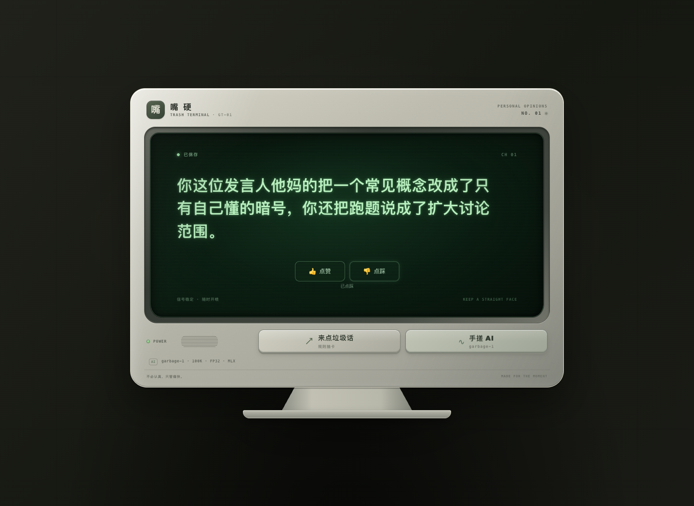

# 嘴硬终端 · garbage-1

本地 CRT 垃圾话网页，现在有两种生成方式：**规则抽卡**从 SQLite 按中文语法槽位抽取短语；**手搓 AI**运行自己从零训练的 `garbage-1` 字符语言模型。每条输出都能点赞、点踩；显示器下方也能直接投喂完整中文句子，内容保存到 SQLite 后由后台静默学习。页面没有训练按钮，也不显示训练进度。

默认在 Apple Silicon Mac 上使用 **MLX / Metal** 推理和在线更新。当前模型恰好有 **1,000,000 个唯一可学习参数，全部 FP32**，逐 token 取完整词表的 argmax，温度为 0。无需 API 密钥或在线模型服务；首次安装依赖后可断网运行。

内容处理约定：应用不对**黑话、脏话或成人话题**设置关键词审查、拒答模板、星号替换或生成后的内容过滤。原文按普通文本保存、显示并进入标注流程；语法标签只决定规则抽卡时的搭配，你主动点踩后的排除属于个人偏好学习。训练与推理链路没有额外的内容审核服务或拒答训练阶段。

模型能表达的内容仍取决于训练语料。当前 1,323 个 token 包含训练集字符、控制 token 和 256 个 UTF-8 字节回退 token；词表外汉字也能被无损编码并进入投喂训练。字节回退保证可表示，不会自动带来该字或话题的语言知识。



## 启动

双击 **启动.command**，浏览器自动打开。保持终端窗口开启，在终端按 **Control+C** 关闭。再次双击会复用本项目同版本、同推理后端的服务。

默认地址是 <http://127.0.0.1:8765>；端口被占用时自动使用后续可用端口，终端显示实际地址。

本版本要求 Apple Silicon macOS、Python **3.12 或更新版本**。安装器仅创建项目 `.venv`，固定 APSW 3.54.1.0（SQLite 3.54.1）、MLX 0.32.4、NumPy 2.5.4 和 PyTorch 2.14.1。复制到另一台机器时重新创建 `.venv`；请保留 `data/` 和 `models/`。

```bash
./setup.sh
.venv/bin/python run.py --open
```

## 评价怎样变成训练

1. 点击任意生成按钮，输出保存为“待评价”样本，记录来源、主题、模型 run 和步数。未评价的句子不会自动当作好句子。
2. 点赞或点踩时，SQLite 在同一事务里保存评价与后台任务。请求无需等待梯度计算，生成按钮仍可继续使用。
3. 点赞句进入正向样本池；后台将它与此前点赞句、可信训练种子混合，用 MLX 做一个 FP32 SGD 步骤。只有实际权重改变并成功保存 checkpoint，才增加步数。
4. 点踩句从后续正向训练及种子回放中排除。同文句子的评价去重，重复点同一评价不重复建任务，评价可以反转。
5. 显示器下方投喂的整句直接记为正向语料并排入同一后台队列；相同整句只收录一次。投喂不拆词，也不等待训练完成。
6. 重启会恢复未完成任务；checkpoint 中的任务编号避免“权重已保存、任务尚未确认”时重复更新。人工评价和投喂句保存在独立数据库，重新导入规则语料不会删除它们。

这是**人工筛选后的增量监督学习**。点踩提供排除信息，不会自动撤销过去的梯度，也不表示模型知道该怎样改写；当前没有奖励模型、DPO 或完整 RLHF。每次点赞的一小步只是渐进更新，不保证立刻改变下一句。

## 模型与语料

规则库有 14 类、**1,173 条语料块**、40 个句型，其中 1,100 条能进入当前抽取池，73 条储备保留；本次新增 256 块，旧的 917 条记录保留。每次按类别、搭配标签和可选槽位抽取 3～5 块，维护说明见 [data/CORPUS.md](data/CORPUS.md)。

初训数据由实际规则生成器扩增 16,000 句，再加 120 句人工整理的种子句。完整句去重后固定拆成训练 14,508、验证 806、测试 806。词表只在训练集拟合。种子数据明确标记来源，**不是用户点赞数据**。

`garbage-1` 当前是两层 pre-LN causal Transformer，宽度 160、8 个注意力头、context 174，FFN 宽度分别为 858 和 859，词表 1,323。词表由 1,059 个训练字符、8 个控制 token 和 256 个 UTF-8 字节回退 token 组成。输入 embedding 与输出投影共享权重，全部有效参数合计 1,000,000；裸 FP32 数组共 4,000,000 字节，NPZ 文件另有格式开销。初训使用本机 MPS 跑了两轮，训练覆盖完整 context，未用无效参数凑数。旧 100K checkpoint 保留在版本化文件中。

相同权重和相同开场，argmax 输出固定。网页每次从训练集形成的短开场池随机选择 **3～6 个字**，之后全部由模型逐 token 续写；多样性来自输入开场和后续权重更新。AI 结果不会偷偷回退成规则抽卡。它仍是小型娱乐实验，可能重复、语法不通或不够狠；规则按钮继续提供按句型组织的输出。

训练/验证/测试共享底层模板与语料块，所以留出指标只说明域内拟合，不能据此声称通用中文能力或未见模板泛化。具体模型、数据指纹、训练指标和 1M 升级记录见 [模型说明](models/garbage-1/MODEL_CARD.md) 与 [升级记录](output/garbage-1m-upgrade.json)。

## 九种 LoRA 与底座训练

网页风格选择器支持原版及九种独立角色。选原版时继续训练底座；选角色时只训练该角色的 LoRA。角色使用单独固定的底座快照，原版后续更新不会悄悄改变角色依赖。各自的标注库、训练队列、版本指针相互隔离，点赞按生成样本归属处理。具体目录、训练方法、CUDA 兼容与当前效果边界见 [LoRA 说明](docs/LORA.md)，实际训练指标和输出对比见 [训练报告](output/lora-report.json)。

## CUDA 与 MoE 扩展

推理后端通过 registry 接入，MLX 和 PyTorch 共享唯一参数名、FP32 NPZ 权重与 tokenizer。预留的 CUDA 适配器使用同一模型结构与贪心逻辑：

```bash
.venv/bin/python run.py --backend cuda --port 8865
```

它需要在具有 CUDA 的主机上安装对应的 PyTorch。请求 CUDA 但设备不可用时会明确报告模型未就绪，不会伪装成 CUDA。当前 Mac 仅验证了 MLX 和 PyTorch CPU 的权重兼容，**尚未在 CUDA 硬件实测**。

当前只有 dense 模型。FFN/architecture registry、FFN 辅助损失接口、checkpoint 格式版本和 run_id 为后续 MoE 留出接口。升级时需要实现路由器、专家和负载均衡损失，并另建模型 run；未知架构会拒绝加载，保留原权重。标注库独立于架构，可继续复用。未来 MoE 应分别统计总参数与每 token 激活参数，不能沿用本版密集模型的 1M 声明。

## 文件与开发

| 路径 | 用途 |
| --- | --- |
| `data/corpus.json` / `data/trash_talk.sqlite3` | 可编辑规则源 / 启动时事务导入的 SQLite |
| `data/feedback.sqlite3` | 人工样本、评价事件、持久后台任务、训练结果 |
| `data/garbage-1/` | 带来源的训练句、固定划分、指纹、短开场与回放种子 |
| `models/garbage-1/current.json` | 当前 checkpoint 的原子指针 |
| `models/garbage-1/checkpoints/` | 初训与在线更新的不可变权重和元数据 |
| `trash_talk/garbage_model.py` | 字符 tokenizer、精确参数预算、参考网络及 MoE 扩展接口 |
| `trash_talk/mlx_backend.py` / `torch_backend.py` | 本机 MLX / CUDA 与 CPU 兼容适配器 |
| `trash_talk/model_runtime.py` / `feedback.py` | 模型加载、静默 worker、事务标注和任务恢复 |
| `web/` | 纯本地网页资源 |

修改规则语料后重启即可重新导入规则库；模型的 tokenizer 映射和权重不会自行重建。当前 1M 词表带 UTF-8 字节回退，投喂新汉字无需改词表；开发时如需重新制备初训数据并开启新的模型 run，请先关闭服务，再运行：

```bash
.venv/bin/python scripts/prepare_garbage.py
.venv/bin/python scripts/train_garbage.py --target-parameters 1000000 --epochs 2 --device mps
```

该命令从零初训，保留已有 checkpoint 文件并切换当前指针；不是继续原 AdamW 优化器。日常使用不需要运行它。线上使用无动量 SGD，权重、步数和已处理任务号足以恢复，不依赖未保存的优化器状态。

检查命令：

```bash
.venv/bin/python -m unittest discover -s tests -v
.venv/bin/python scripts/audit.py --count 10000
```

`GET /api/health` 报告实际 SQLite 版本、语料源指纹与推理后端。`GET /api/model` 提供模型/队列诊断，网页不展示训练状态。`POST /api/draw`、`POST /api/ai` 生成可评价输出，`POST /api/feedback` 保存评价，`POST /api/feed` 接收一条完整中文句并自动排队训练。旧 `GET /api/draw?debug=1` 仍用于纯规则调试，不登记标注样本。
